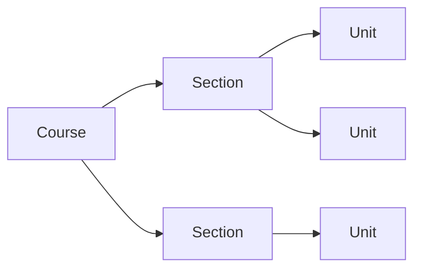
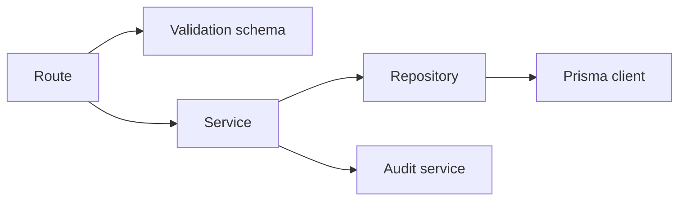
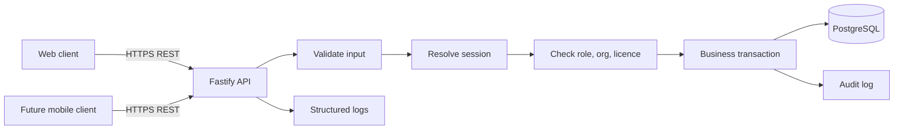
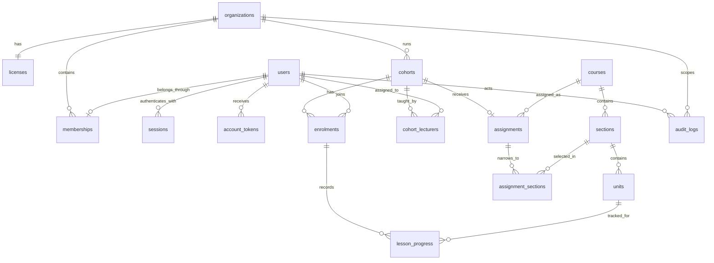
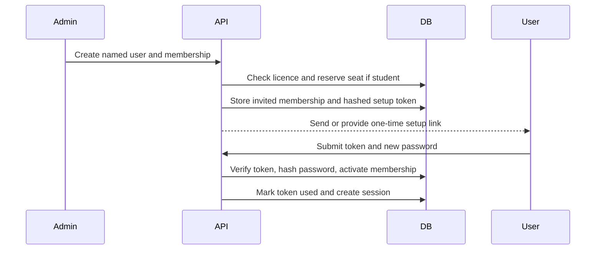
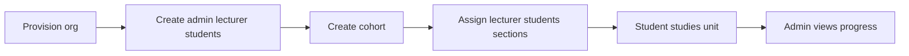

# Baharia LMS: architecture and implementation plan

**Status:** Proposed for team review  
**Decision requested:** Approve the Phase 1 product boundary, technical stack, models, security baseline, frontend areas, and delivery phases before implementation starts.

## 1. Executive summary

Baharia will be a cloud-first LMS for maritime colleges and training institutions. Angus supplies and maintains the maritime learning content. Institutions use the platform to manage named users, organize students into cohorts, assign course sections, deliver lessons, and review progress.

This is a new product. The current Baharia prototype is useful for content and interaction references, but it is not the production frontend or the foundation of the new repository structure.

### Phase 1 outcome

At the end of Phase 1:

1. Baharia can provision an institution and set its student seat limit.
2. Institution administrators can manage lecturers and students.
3. Administrators can create cohorts, assign lecturers, enrol students, and assign a complete course or selected sections.
4. Students can study assigned units and record progress.
5. Lecturers can view teaching notes and progress for their cohorts.
6. Institution administrators can see seats, rosters, completion, and last activity.
7. Platform administrators can publish Angus's centrally managed catalogue and suspend an unpaid institution.

### Explicitly deferred

- Time-on-page heartbeats and detailed engagement analytics
- Native mobile application
- Quizzes and examinations
- Certificates and STCW certification workflows
- Institution-authored course content
- Multiple organizations per user
- SSO and MFA
- Offline or on-premises installation
- Payments and automated billing

## 2. Product and ownership model

### Product roles

| Role | Scope | Main responsibility |
|---|---|---|
| Platform administrator | Entire platform | Provision institutions, set licences, publish content, support accounts |
| Institution administrator | One institution | Manage people, cohorts, assignments, seats, and reports |
| Lecturer | Assigned cohorts in one institution | Teach assigned content and review student progress |
| Student | Own account and enrolments | Study assigned units and record progress |

For the MVP, every non-platform user belongs to exactly one organization. This keeps authorization and support simple. The schema can evolve later if real customers require lecturers to work across institutions.

### Content ownership

- Angus provides and maintains the maritime content.
- Baharia publishes it centrally.
- Institutions select the sections required by their syllabus.
- Institutions cannot upload or alter shared content in Phase 1.
- Baharia does not issue STCW certificates.

### Content hierarchy



Example:

- Course: Nautical Science
- Section: Watchkeeping
- Unit: Taking over and handing over a watch

The catalogue is not duplicated for Level 5, Level 6, or each institution. A cohort receives the whole course or a selected set of sections.

## 3. Proposed technology stack

### Backend

| Technology | Purpose | Reason |
|---|---|---|
| Node.js 22 LTS | Runtime | Familiar ecosystem, strong TypeScript support, suitable for API and event workloads |
| TypeScript | Application language | Static checking and safer contracts across web, API, and future mobile clients |
| Fastify | HTTP framework | Small core, good performance, schema hooks, plugins, and structured logging |
| PostgreSQL | Primary database | Transactions, constraints, relational reporting, and reliable managed hosting |
| Prisma ORM | Typed database client | Mature ecosystem and readable models for developers and coding agents |
| Prisma Migrate | Schema migrations | Versioned, reviewable migrations with a conventional workflow |
| Zod | Boundary validation | Validates environment configuration and shared request/response contracts |
| Pino | Structured logging | Built into Fastify and suitable for production log aggregation |
| Vitest | Unit/integration tests | Fast TypeScript testing with a familiar API |

Prisma is selected over Drizzle because the team is more familiar with it and its schema is easy to review. Drizzle is newer and more SQL-oriented, but it does not provide enough benefit here to justify introducing a less familiar tool.

### Frontend

| Technology | Purpose |
|---|---|
| React + TypeScript | New production web application |
| Vite | Development and production build |
| React Router | Role-aware routing |
| TanStack Query | Server-state fetching, mutation, and cache handling |
| React Hook Form + Zod | Forms and shared validation |

The production web app will be newly built. It may reuse validated copy or content examples from the prototype, but should not inherit the prototype's session storage, routes, or component structure.

### Future mobile

The first client is a responsive web app. A later student-focused mobile app can use Expo and React Native. The API must remain client-neutral from the start:

- Stable resource IDs
- Versioned REST routes
- Pagination
- Shared request/response contracts
- Authentication resolved before domain services
- No business rules tied to cookies or browser routing

The plan does not promise shared UI components between React DOM and React Native. Shared contracts and domain terminology are valuable; forced cross-platform UI reuse is not.

## 4. Repository structure

The new product should use an npm-workspaces monorepo.

```text
baharia/
├── apps/
│   ├── api/
│   │   ├── prisma/
│   │   │   ├── schema.prisma
│   │   │   ├── migrations/
│   │   │   └── seed.ts
│   │   ├── src/
│   │   │   ├── config/
│   │   │   ├── plugins/
│   │   │   ├── lib/
│   │   │   ├── modules/
│   │   │   │   ├── auth/
│   │   │   │   ├── organizations/
│   │   │   │   ├── memberships/
│   │   │   │   ├── catalogue/
│   │   │   │   ├── cohorts/
│   │   │   │   ├── learning/
│   │   │   │   └── reports/
│   │   │   ├── app.ts
│   │   │   └── server.ts
│   │   └── tests/
│   ├── web/
│   │   ├── src/
│   │   │   ├── app/
│   │   │   ├── api/
│   │   │   ├── components/
│   │   │   ├── features/
│   │   │   ├── layouts/
│   │   │   ├── pages/
│   │   │   └── styles/
│   │   └── tests/
│   └── mobile/
│       └── README.md
├── packages/
│   ├── contracts/
│   └── ui/
├── docs/
├── package.json
└── tsconfig.base.json
```

`apps/mobile/` is a documented placeholder, not a Phase 1 application.

### API folder responsibilities

| Path | Responsibility | Must not contain |
|---|---|---|
| `config/` | Parse and validate environment variables | Business rules |
| `plugins/` | Prisma, authentication, security headers, CORS, rate limits | Feature-specific logic |
| `lib/` | Error envelope, pagination, IDs, logging helpers | A miscellaneous collection of business logic |
| `modules/*/routes.ts` | HTTP methods, paths, schemas, status codes | Raw database queries |
| `modules/*/schema.ts` | Input/output validation | Database access |
| `modules/*/service.ts` | Authorization-aware business rules and transactions | Fastify response manipulation |
| `modules/*/repository.ts` | Prisma queries scoped by supplied IDs | Authorization decisions |
| `modules/*/types.ts` | Module-only internal types | Duplicates of shared contracts |
| `app.ts` | Construct Fastify and register plugins/routes | Start the process |
| `server.ts` | Load config, call `listen`, handle shutdown | Feature registration details |
| `prisma/schema.prisma` | Database models and constraints Prisma supports | Runtime application logic |
| `prisma/migrations/` | Immutable migration history | Hand-edited deployed migrations |
| `prisma/seed.ts` | Repeatable development/demo data | Production-only secrets |

Each feature module follows the same dependency direction:



Routes translate HTTP. Services decide what is allowed. Repositories query data. This separation makes authorization and transaction rules testable without starting the server.

### Web folder responsibilities

| Path | Responsibility |
|---|---|
| `app/` | Router, providers, app startup, route guards |
| `api/` | Typed API client and query-client configuration |
| `components/` | Generic presentational components |
| `features/` | Role/domain features such as cohorts, people, progress |
| `layouts/` | Public, platform, institution, lecturer, and student shells |
| `pages/` | Route-level composition only |
| `styles/` | Tokens, global styles, accessibility and responsive rules |

No page should call `fetch` directly. Feature query/mutation hooks use the typed API client. The server remains the authority for permissions.

### Shared packages

`packages/contracts` contains:

- Request and response schemas
- Pagination shape
- Error envelope
- Shared enums exposed by the API
- Generated TypeScript types

It must not contain Prisma models, secrets, server code, React components, or business rules.

`packages/ui` is optional and web-only in Phase 1. It should contain stable visual primitives after repeated use proves they are shared. It must not delay feature delivery.

## 5. Runtime architecture



### Request lifecycle

1. The client sends an HTTPS request.
2. Fastify applies request-size limits, CORS, rate limiting, and security headers.
3. The route validates path, query, and body data.
4. The authentication plugin resolves the session and user.
5. The service checks role, organization, membership, and licence state.
6. The service executes the business operation, using a transaction when multiple facts must change together.
7. Important administrative actions produce an audit entry.
8. The route returns a documented response or consistent error envelope.

## 6. Data model

### Domains and tables

| Domain | Tables |
|---|---|
| Identity and tenancy | `organizations`, `licenses`, `users`, `memberships` |
| Authentication | `sessions`, `account_tokens` |
| Catalogue | `courses`, `sections`, `units` |
| Delivery | `cohorts`, `cohort_lecturers`, `enrolments`, `assignments`, `assignment_sections` |
| Learning | `lesson_progress` |
| Operations | `audit_logs` |

### Relationship diagram



Detailed fields and keep/cut decisions remain in [`lms-schema.md`](./lms-schema.md). The following corrections are authoritative and should be applied when implementation starts:

1. Add `memberships.status` with `invited`, `active`, and `suspended`.
2. Add `cohort_lecturers`; lecturer access cannot be implemented without it.
3. Add `sessions`, `account_tokens`, and `audit_logs`.
4. Add `assignments.scope` with `full_course` or `selected_sections`.
5. Seat usage counts active student memberships, not enrolment rows.

### Core field decisions

#### `organizations`

`id`, `name`, `status`, `created_at`, `updated_at`

- `status`: `active` or `suspended`
- No address, custom domain, or white-label settings in Phase 1.

#### `licenses`

`id`, `organization_id`, `seat_limit`, `status`, `starts_at`, `ends_at`, `created_at`, `updated_at`

- Unique `organization_id`
- `seat_limit` must be positive.
- `status`: `trial`, `active`, `expired`, or `suspended`
- Pricing and payment-provider fields remain outside Phase 1.

#### `users`

`id`, `email`, `name`, `password_hash`, `is_platform_admin`, `created_at`, `updated_at`

- Case-insensitive unique email.
- `password_hash` can be null before account setup.
- No phone number or profile image initially.

#### `memberships`

`id`, `user_id`, `organization_id`, `role`, `status`, `created_at`, `updated_at`

- Unique `user_id` enforces one organization per normal user in Phase 1.
- `role`: `institution_admin`, `lecturer`, or `student`
- `status`: `invited`, `active`, or `suspended`
- Active student memberships consume seats.

#### `sessions`

`id`, `user_id`, `token_hash`, `expires_at`, `last_used_at`, `user_agent`, `ip_address`, `created_at`, `revoked_at`

- Store only a SHA-256 hash of the random token.
- A user may have at most two active sessions initially.
- `user_agent` and `ip_address` support account-sharing review and security investigation; retention must be documented.

#### `account_tokens`

`id`, `user_id`, `type`, `token_hash`, `expires_at`, `used_at`, `created_at`

- `type`: `account_setup` or `password_reset`
- Tokens are single-use, random, short-lived, and stored only as hashes.
- Issuing a replacement invalidates previous unused tokens of that type.

#### `courses`

`id`, `title`, `status`, `created_at`, `updated_at`

- `status`: `draft` or `published`
- Platform administrators manage the catalogue in Phase 1.

#### `sections`

`id`, `course_id`, `title`, `sort_order`, `created_at`, `updated_at`

- Unique `(course_id, sort_order)`
- Titles need not be globally unique.

#### `units`

`id`, `section_id`, `title`, `body`, `teaching_notes`, `sort_order`, `version`, `created_at`, `updated_at`

- `body` and `teaching_notes` use Markdown.
- Teaching notes are never returned to student endpoints.
- `version` increments when published content changes; full version history is deferred.

#### `cohorts`

`id`, `organization_id`, `name`, `status`, `created_at`, `updated_at`

- `status`: `active` or `archived`
- Unique `(organization_id, name)` among active cohorts.

#### `cohort_lecturers`

`cohort_id`, `lecturer_membership_id`, `created_at`

- Composite primary key.
- The lecturer membership must belong to the cohort's organization and have lecturer role. The service enforces this invariant transactionally.

#### `enrolments`

`id`, `cohort_id`, `student_membership_id`, `status`, `created_at`, `updated_at`

- Unique `(cohort_id, student_membership_id)`
- `status`: `active` or `withdrawn`
- Enrolment does not consume an additional seat because the active student membership already consumes one.

#### `assignments`

`id`, `cohort_id`, `course_id`, `scope`, `created_at`, `updated_at`

- Unique `cohort_id` gives one assigned course per cohort in Phase 1.
- `scope`: `full_course` or `selected_sections`

#### `assignment_sections`

`assignment_id`, `section_id`, `created_at`

- Composite primary key.
- Required only when assignment scope is `selected_sections`.
- The section must belong to the assignment's course.

#### `lesson_progress`

`id`, `enrolment_id`, `unit_id`, `status`, `started_at`, `completed_at`, `last_seen_at`, `created_at`, `updated_at`

- Unique `(enrolment_id, unit_id)`
- `status`: `in_progress` or `completed`
- Absence of a row means not started.
- The unit must be available through the enrolment's assignment.

#### `audit_logs`

`id`, `organization_id`, `actor_user_id`, `action`, `entity_type`, `entity_id`, `metadata`, `created_at`

- Append-only from the application.
- `organization_id` can be null for platform-only actions.
- Metadata must not contain passwords, raw tokens, lesson bodies, or other secrets.

## 7. Authentication design

Custom authentication is acceptable because the required scope is narrow. “Custom” means owning account and session flows while relying on proven cryptographic libraries. It does not mean designing cryptography.

### Account setup flow



For an early pilot without transactional email, the admin can securely copy the one-time setup link to the user. The API should still model it as a one-time token so adding email later does not change account security.

### Password handling

- Hash passwords with Argon2id using reviewed library defaults adjusted to server capacity.
- Never encrypt or log plaintext passwords.
- Enforce a minimum length of 12 characters; allow password managers and long passphrases.
- Do not impose composition rules that encourage predictable patterns.
- Password reset responses remain generic whether an email exists or not.

### Session handling

- Generate at least 256 bits of cryptographically random session material.
- Store only `SHA-256(token)` in PostgreSQL.
- Web receives the raw token in a `__Host-baharia_session` cookie with `HttpOnly`, `Secure`, `SameSite=Lax`, `Path=/`, and no `Domain`.
- Rotate the session after login and password changes.
- Revoke all sessions on password reset.
- Expire inactive sessions and enforce an absolute lifetime.
- Initially allow two active sessions per user. Creating a third revokes the oldest or asks the user to manage sessions.

A future mobile app can submit the same opaque token through `Authorization: Bearer`. It stores the token in iOS Keychain or Android Keystore through Expo SecureStore. Domain services receive an authenticated principal and do not care how the token arrived.

### CSRF and browser controls

- SameSite cookies provide the first CSRF barrier.
- State-changing web requests must pass an exact `Origin` check.
- CORS allows only the deployed web origin and local development origin.
- Do not use wildcard CORS with credentials.
- Auth tokens never enter localStorage or sessionStorage.

## 8. Authorization and tenancy

Every protected service receives:

```text
AuthenticatedPrincipal
  userId
  isPlatformAdmin
  organizationId
  membershipId
  role
  membershipStatus
  licenseStatus
```

The API must not accept `organization_id` from normal clients as proof of scope. It derives organization scope from the authenticated membership.

### Permission matrix

| Capability | Platform admin | Institution admin | Lecturer | Student |
|---|---:|---:|---:|---:|
| Provision organization/licence | Yes | No | No | No |
| Suspend organization | Yes | No | No | No |
| Publish catalogue | Yes | No | No | No |
| View own institution seats | Yes | Yes | No | No |
| Manage institution people | Support only | Yes | No | No |
| Create/manage cohorts | Support only | Yes | No | No |
| Assign lecturers and content | Support only | Yes | No | No |
| View all institution reports | Support only | Yes | No | No |
| View assigned cohort progress | No by default | Yes | Yes | No |
| Read teaching notes | Yes | Yes | Yes | No |
| Read assigned student content | Support only | Yes | Yes | Yes |
| Update own progress | No | No | No | Yes |

“Support only” means the route is not part of normal platform administration and should require an explicit, audited support action if added later.

## 9. Licence and account-sharing protection

The MVP should prevent casual unpaid reuse without introducing DRM or invasive tracking.

### Controls

1. **No reusable licence keys.** An institution licence enables an organization; it is not a password shared among students.
2. **Named accounts only.** Every lecturer and student receives a personal account.
3. **No public registration.** Institution administrators invite people under their organization.
4. **Seat enforcement.** Every active student membership consumes one seat, regardless of how many cohorts the student joins.
5. **Transactional activation.** Student activation and seat counting occur in one database transaction with the licence row locked.
6. **Licence checks.** Every protected request requires an active/trial licence, active organization, and active membership.
7. **Immediate suspension.** Suspending a licence blocks all institution users without deleting records.
8. **Session limit.** Two active sessions per user provide normal phone/laptop use while discouraging broad account sharing.
9. **Session visibility.** Users and administrators can see and revoke active sessions with created and last-used times.
10. **Audit evidence.** Role changes, seat changes, account state changes, repeated login failures, and administrative session revocations are recorded.
11. **Basic alerting later.** Repeated simultaneous use from many unrelated networks can be reviewed, but automated geographic blocking is deferred.

### Honest limitation

No ordinary web platform can prove which human is behind a valid username and password. The MVP limits casual sharing and makes misuse visible. It does not use device fingerprinting, hardware locking, continuous location tracking, or other controls that would harm legitimate students and increase support work.

## 10. Data integrity and security baseline

### Database integrity

- Foreign keys on every relationship
- Unique constraints described in the model section
- Check constraints for positive seat limits and allowed status values where Prisma migrations require explicit SQL
- Required fields non-null by default
- No hard deletion of organizations, memberships with history, cohorts, enrolments, progress, or audit logs
- Transactions for student activation, role/status changes, assignments, and progress transitions
- Indexes on foreign keys and report filters
- Database timestamps generated consistently in UTC

### Important service invariants

- Membership organization must match the target cohort organization.
- Lecturer assignment requires an active lecturer membership.
- Enrolment requires an active student membership.
- Selected sections must belong to the assigned course.
- Student unit access must resolve through cohort assignment.
- Students may update only their own progress.
- Completed progress cannot silently move backwards.
- Teaching notes are filtered at the query/response layer, not merely hidden in the UI.

### Application security

- TLS for all production traffic
- Helmet-compatible security headers, including a restrictive Content Security Policy
- Request body limits and accepted content types
- Zod validation at every external boundary
- Parameterized Prisma queries
- Markdown rendering through a sanitizing allowlist to prevent stored XSS
- Rate limits on login, setup/reset token use, and account creation
- Generic public errors; structured internal logs with request IDs
- Secrets stored in deployment environment variables, never committed
- Dependency update and vulnerability checks in CI

### Operational integrity

- Separate development, staging, and production databases
- Automated daily database backups from the managed provider
- A documented and periodically tested restore procedure
- Health/readiness endpoint that checks process and database availability
- Error monitoring and alerts for auth failures, API error spikes, and failed migrations
- Audit-log retention policy
- Session/IP metadata retention policy appropriate to applicable privacy obligations

### Deferred hardening

- PostgreSQL row-level security
- MFA
- SSO/SAML
- Web application firewall tuning
- Automated account-takeover scoring
- Device fingerprinting
- Field-level encryption beyond provider disk encryption

These can be added based on institutional requirements. They should not replace correct application authorization.

## 11. API design

### Conventions

- Base path: `/api/v1`
- JSON request and response bodies
- UUID resource IDs
- Cursor or page-based pagination, selected once before implementation
- ISO 8601 UTC timestamps
- Idempotent `PUT` where replacing a single assignment
- Consistent errors:

```json
{
  "error": {
    "code": "SEAT_LIMIT_REACHED",
    "message": "The institution has no available student seats.",
    "requestId": "..."
  }
}
```

Expected status codes:

- `400`: malformed request
- `401`: no valid session
- `403`: authenticated but not permitted
- `404`: missing resource or resource outside caller scope
- `409`: state conflict, duplicate, or seat limit
- `422`: valid JSON that fails domain validation
- `429`: rate limited

### Phase 1 endpoint groups

#### Authentication

| Method | Path | Purpose |
|---|---|---|
| `POST` | `/auth/login` | Start session |
| `POST` | `/auth/logout` | Revoke current session |
| `POST` | `/auth/setup` | Set initial password using one-time token |
| `POST` | `/auth/forgot-password` | Request reset without revealing account existence |
| `POST` | `/auth/reset-password` | Reset with one-time token |
| `GET` | `/me` | Return principal, role, org, and active session |
| `GET` | `/me/sessions` | List active sessions |
| `DELETE` | `/me/sessions/:id` | Revoke a session |

#### Platform administration

| Method | Path | Purpose |
|---|---|---|
| `GET` | `/platform/organizations` | List institutions and seat usage |
| `POST` | `/platform/organizations` | Create organization, licence, and first admin |
| `GET` | `/platform/organizations/:id` | Review organization/licence |
| `PATCH` | `/platform/organizations/:id` | Change organization status |
| `PATCH` | `/platform/organizations/:id/license` | Change cap or licence status |

#### People

| Method | Path | Purpose |
|---|---|---|
| `GET` | `/memberships` | List people in caller's organization |
| `POST` | `/memberships` | Create named account and membership |
| `GET` | `/memberships/:id` | View a person |
| `PATCH` | `/memberships/:id` | Change name, role, or status under rules |
| `POST` | `/memberships/:id/resend-setup` | Replace setup token/link |

#### Catalogue

| Method | Path | Purpose |
|---|---|---|
| `GET` | `/courses` | List published courses available to caller |
| `GET` | `/courses/:id` | Course and sections |
| `GET` | `/units/:id` | Role-filtered unit content |
| `POST/PATCH` | `/platform/courses` | Platform catalogue management |
| `POST/PATCH` | `/platform/sections` | Platform section management |
| `POST/PATCH` | `/platform/units` | Platform unit management |
| `POST` | `/platform/courses/:id/publish` | Publish validated course |

#### Cohorts and delivery

| Method | Path | Purpose |
|---|---|---|
| `GET/POST` | `/cohorts` | List/create cohorts |
| `GET/PATCH` | `/cohorts/:id` | View/update cohort |
| `PUT` | `/cohorts/:id/lecturers` | Replace assigned lecturers |
| `POST` | `/cohorts/:id/enrolments` | Enrol active student |
| `PATCH` | `/cohorts/:id/enrolments/:enrolmentId` | Withdraw/reactivate enrolment |
| `PUT` | `/cohorts/:id/assignment` | Assign course and scope |

#### Learning and reporting

| Method | Path | Purpose |
|---|---|---|
| `GET` | `/my/learning` | Student's assigned course/sections/progress |
| `PUT` | `/my/progress/:unitId` | Start or complete accessible unit |
| `GET` | `/cohorts/:id/roster` | Admin/lecturer roster |
| `GET` | `/cohorts/:id/progress` | Completion and last activity |
| `GET` | `/dashboard` | Role-specific summary |

OpenAPI generation is useful during implementation, but the approval document intentionally remains at resource-contract level.

## 12. Frontend information architecture

### Public and account area

| Route | Screen | Main action |
|---|---|---|
| `/` | Product landing | Understand offer and contact team |
| `/login` | Login | Authenticate |
| `/account/setup` | Account setup | Use one-time link and create password |
| `/forgot-password` | Forgot password | Request reset |
| `/reset-password` | Reset password | Choose new password |

### Platform administrator

| Route | Screen | Main data/actions |
|---|---|---|
| `/platform` | Platform dashboard | Institution counts, active/expired licences, seats |
| `/platform/organizations` | Organizations | Search/list institutions |
| `/platform/organizations/new` | Provision institution | Name, first admin, seat cap, licence dates |
| `/platform/organizations/:id` | Institution detail | Licence, seat usage, status, audited controls |
| `/platform/catalogue` | Catalogue | Courses and publication status |
| `/platform/catalogue/:courseId` | Course editor | Sections, units, ordering, publish |

### Institution administrator

| Route | Screen | Main data/actions |
|---|---|---|
| `/admin` | Institution dashboard | Seats, cohorts, students, completion, recent activity |
| `/admin/people` | People | Add, filter, activate, suspend lecturers/students |
| `/admin/people/:id` | Person detail | Role, status, cohorts, sessions, progress summary |
| `/admin/cohorts` | Cohorts | List/create/archive |
| `/admin/cohorts/:id` | Cohort detail | Roster, lecturers, assignment, progress |
| `/admin/cohorts/:id/assignment` | Assign content | Full course or selected sections |
| `/admin/reports/progress` | Progress report | Student/cohort completion and last activity |
| `/admin/settings/sessions` | Session oversight | Revoke compromised user sessions |

### Lecturer

| Route | Screen | Main data/actions |
|---|---|---|
| `/lecturer` | Lecturer dashboard | Assigned cohorts, incomplete students, recent activity |
| `/lecturer/cohorts/:id` | Cohort view | Roster and progress |
| `/lecturer/courses/:courseId` | Teaching view | Sections, units, teaching notes |
| `/lecturer/units/:unitId` | Unit teaching view | Student content plus private teaching notes |

### Student

| Route | Screen | Main data/actions |
|---|---|---|
| `/learn` | Student dashboard | Assigned course and overall progress |
| `/learn/courses/:courseId` | Course view | Assigned sections and unit progress |
| `/learn/units/:unitId` | Unit study | Read content, start/complete unit |
| `/account/sessions` | Sessions | Review/revoke own sessions |

### Shared behavior

- Responsive navigation
- Loading skeletons for primary pages
- Useful empty states that tell the user what action is required
- Retryable network errors
- Access-denied and not-found pages
- Keyboard navigation, clear focus states, semantic headings, labels, and contrast
- No authorization decisions based only on route guards

### Mobile plan

The responsive web app is the Phase 1 student experience. The native app is considered after real web usage shows a need, likely beginning with:

- Login/account session
- Download/view assigned course outline
- Unit reading
- Progress updates
- Optional offline reading in a later mobile phase

Platform and institution administration remain web-first unless customers demonstrate a need for native administration.

## 13. Reporting and Phase 2 analytics

### Phase 1 reports

- Seats used and available
- Student roster by cohort
- Units started/completed
- Last activity
- Completion totals by student and cohort

### Phase 2 time-on-page

Add a `lesson_events` table only when implemented:

`id`, `enrolment_id`, `unit_id`, `event_type`, `seconds`, `occurred_at`

The client sends bounded heartbeats only while:

- The unit page is visible
- The browser/app is active
- The authenticated student retains access

The API validates maximum heartbeat size and deduplicates retries. Reports use aggregated dwell time, not raw event scans. “Time spent” is an engagement signal, not proof of attention or competence, and the UI must label it accordingly.

## 14. Testing strategy

### Unit tests

- Seat availability and membership activation
- Licence and organization status checks
- Role permission rules
- Assignment scope resolution
- Progress transition rules
- Session limits and token expiry

### Integration tests

Run the Fastify app against a disposable PostgreSQL database:

- Login/setup/reset/logout
- Organization provisioning transaction
- Student activation at and beyond seat cap
- Cohort lecturer and student organization checks
- Full-course and selected-section assignment
- Student access to assigned and unassigned units
- Teaching-note filtering
- Admin/lecturer report scoping

### Authorization matrix tests

For each sensitive endpoint:

- Unauthenticated caller fails
- Wrong role fails
- Same role from another organization fails
- Suspended membership fails
- Suspended/expired licence fails
- Correct principal succeeds

### End-to-end acceptance path



## 15. Environments and deployment

### Environments

| Environment | Purpose | Data |
|---|---|---|
| Development | Local implementation | Seeded fictional data |
| Staging | Team/customer review | Fictional or explicitly approved test data |
| Production | Live institutions | Real accounts and learning records |

No production database is copied into development.

### Deployment proposal

- Web: Vercel
- API: managed Node.js web service
- Database: managed PostgreSQL in the same region as API
- DNS: `app.<domain>` for web, `api.<domain>` for API
- CI: lint, typecheck, unit tests, integration tests, production build
- Deployment: apply reviewed Prisma migrations before starting compatible API
- Rollback: application rollback plus forward database correction; never automatically reverse destructive production migrations

Provider selection is an implementation decision. The architecture requires a persistent Node process or compatible service, HTTPS, environment secrets, managed PostgreSQL, logs, health checks, and backups.

## 16. Delivery phases

### Phase 0: approval and setup

- Approve this document
- Confirm first institution and first Angus course
- Confirm content credit/branding
- Create new monorepo structure and environments

### Phase 1A: backend foundation

- Prisma schema and migrations
- Authentication and sessions
- Organizations, licences, memberships, and seat enforcement
- Catalogue management/read API
- Cohorts, lecturers, enrolments, and assignments
- Progress and basic reports
- Audit logs, security controls, tests, and seed

### Phase 1B: new responsive web app

- Account flows
- Platform administration
- Institution administration
- Lecturer teaching/progress views
- Student learning flow
- Accessibility, error handling, and end-to-end tests

### Phase 1C: pilot hardening

- Pilot feedback
- Restore test
- Security review
- Performance checks
- Support and incident runbook
- Production launch decision

### Phase 2: engagement analytics

- Time-on-page event ingestion
- Aggregation
- Engagement reports and exports
- Data retention rules

### Later, demand-led work

- Expo/React Native mobile app
- Offline mobile content
- Assessments and question banks
- Institution content uploads
- Certificates
- MFA and SSO
- Multi-organization users
- LAN/on-premises deployment

## 17. Decisions required for greenlight

The team should explicitly approve or amend:

1. Node.js, TypeScript, Fastify, PostgreSQL, and Prisma.
2. A new responsive React web app, with native mobile deferred.
3. One organization per user in Phase 1.
4. Active named student memberships as the seat-counting rule.
5. Custom email/password auth using Argon2id and opaque server sessions.
6. Two active sessions per user as the initial sharing deterrent.
7. Central Angus-authored catalogue with no institution uploads.
8. One course per cohort, assignable in full or by selected sections.
9. The Phase 1 frontend areas and API resources.
10. The security, integrity, backup, and audit baseline.
11. Time-on-page analytics as Phase 2.
12. The explicitly deferred list.

Once these are approved, backend implementation can start without requiring a polished frontend first.
