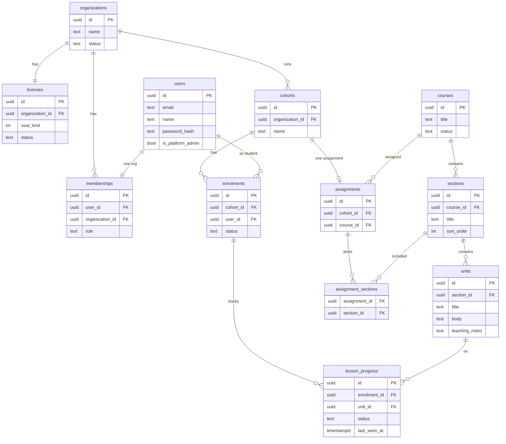

# Baharia LMS — MVP schema

**Scope:** Phase 1 backend. One user → one organization. Role on `memberships`. No multi-college accounts. No time-on-page until Phase 2.

**Ask the room:** Approve these 11 tables and Phase 1 APIs so we can build the backend. Frontend polish is separate.

---

## Relationship diagram

Org has licence + people (memberships) + classes (cohorts) → cohort enrols students and gets one assignment (course + optional sections) → sections contain units → enrolment tracks progress per unit.

---

## Domains → models → tables

| Domain | Models | Tables |
|---|---|---|
| Identity & tenancy | Organization, Licence, User, Membership | `organizations`, `licenses`, `users`, `memberships` |
| Catalogue | Course, Section, Unit | `courses`, `sections`, `units` |
| Delivery | Cohort, Enrolment, Assignment | `cohorts`, `enrolments`, `assignments`, `assignment_sections` |
| Learning | Progress | `lesson_progress` |

---

## Field-by-field (keep / cut)

### `organizations`

| Field | Keep? | Notes |
|---|---|---|
| `id` | yes | |
| `name` | yes | College name |
| `status` | yes | `active` \| `suspended` |
| address, branding, domain allow-list | **cut** | Later |

### `licenses`

| Field | Keep? | Notes |
|---|---|---|
| `id` | yes | |
| `organization_id` | yes | One licence row per org in MVP |
| `seat_limit` | yes | Commercial lever |
| `status` | yes | `trial` \| `active` \| `suspended` |
| price, billing period, invoices | **cut** | Outside LMS |

### `users`

| Field | Keep? | Notes |
|---|---|---|
| `id` | yes | |
| `email` | yes | Login |
| `name` | yes | |
| `password_hash` | yes | |
| `is_platform_admin` | yes | You; not an org membership |
| phone, avatar, last_login | **cut** | Later |

### `memberships`

| Field | Keep? | Notes |
|---|---|---|
| `id` | yes | |
| `user_id` | yes | Unique in MVP → one org per user |
| `organization_id` | yes | |
| `role` | yes | `institution_admin` \| `lecturer` \| `student` |
| invited_at, job title | **cut** | Later |

### `courses`

| Field | Keep? | Notes |
|---|---|---|
| `id` | yes | |
| `title` | yes | e.g. Nautical Science |
| `status` | yes | `draft` \| `published` |
| summary, cover, KNQF level | **cut** | Syllabus stays with the college |

### `sections`

| Field | Keep? | Notes |
|---|---|---|
| `id` | yes | |
| `course_id` | yes | |
| `title` | yes | e.g. Watchkeeping |
| `sort_order` | yes | Teaching / UI order |
| summary | **cut** | Title is enough |

### `units`

| Field | Keep? | Notes |
|---|---|---|
| `id` | yes | |
| `section_id` | yes | |
| `title` | yes | |
| `body` | yes | In-app study content (markdown/HTML) |
| `teaching_notes` | yes | Lecturer/admin only; API strips for students |
| hours, tags, outcomes column | **cut** | Outcomes can live inside `body` |

### `cohorts`

| Field | Keep? | Notes |
|---|---|---|
| `id` | yes | |
| `organization_id` | yes | |
| `name` | yes | e.g. OOW Jan 2026 |
| starts_at, ends_at | **cut** | Until a college asks |

### `enrolments`

| Field | Keep? | Notes |
|---|---|---|
| `id` | yes | |
| `cohort_id` | yes | |
| `user_id` | yes | Unique with cohort |
| `status` | yes | `active` \| `withdrawn` — only `active` counts to seats |
| invited status | **cut** | Admin adds people who can log in |

### `assignments`

| Field | Keep? | Notes |
|---|---|---|
| `id` | yes | |
| `cohort_id` | yes | One assignment per cohort in MVP |
| `course_id` | yes | |

### `assignment_sections`

| Field | Keep? | Notes |
|---|---|---|
| `assignment_id` | yes | |
| `section_id` | yes | Empty set = whole course; how L5/L6 share catalogue |
| per-unit assignment | **cut** | Too fine for MVP |

### `lesson_progress`

| Field | Keep? | Notes |
|---|---|---|
| `id` | yes | |
| `enrolment_id` | yes | |
| `unit_id` | yes | Unique with enrolment |
| `status` | yes | `not_started` \| `in_progress` \| `completed` |
| `last_seen_at` | yes | Admin “last activity” |
| percent, score, dwell_seconds | **cut** | Dwell = Phase 2 |

---

## Dropped from MVP

| Table | Why |
|---|---|
| `lesson_events` | To track Time-on-page / heartbeats = Phase 2 |
| quizzes, uploads, certificates | Explicitly out |

**Phase 2 add:** `lesson_events` (`enrolment_id`, `unit_id`, `type`, `seconds`, `created_at`) and optionally `dwell_seconds` on `lesson_progress`.

---

## Phase 1 backend build

**In scope:** auth · provision org/licence/admin · people via memberships · cohorts · enrol with seat check · assign course/sections · student unit list + progress · admin roster + completion.

**Out of Phase 1:** time-on-page dashboards, CSV engagement export, quizzes, institution uploads, certificates, multi-org users, LAN install.

### API surface (conceptual)

| Area | Endpoints |
|---|---|
| Auth | `POST /auth/login`, `POST /auth/logout`, `GET /me` |
| Platform | `POST /organizations`, `PATCH /licenses/:id` |
| People | `GET/POST /memberships` |
| Classes | `GET/POST /cohorts`, `POST /cohorts/:id/enrolments` |
| Assign | `PUT /cohorts/:id/assignment` |
| Study | `GET /my/units`, `GET /units/:id`, `POST /units/:id/progress` |
| Reports | `GET /cohorts/:id/roster`, `GET /cohorts/:id/progress` |

---

